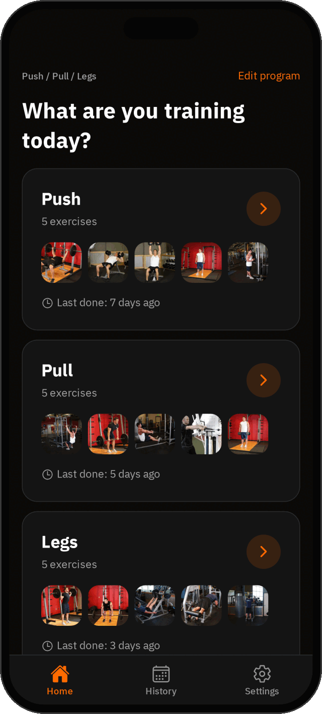

# Gym Tracker

A personal, offline gym workout tracker for iOS and Android, in English and Arabic. Pick a training split, choose the exercises for each day, and log weight and reps for every set. When you start an exercise you immediately see what you lifted last time, with the inputs already filled in.

## Features

- **Training splits**: Push/Pull/Legs, Upper/Lower, Big + Small Muscle, Full Body and PPL + Upper, with exercises and targets (sets, rep range, rest) per day.
- **Fast set logging**: last time's numbers pre-filled in grey, big −/+ buttons, one tap to save a set, warm-up sets, extra exercises per workout.
- **Never loses data**: every confirmed set is saved immediately; unconfirmed edits survive the app being closed; an unfinished workout can be resumed.
- **Progressive overload**: suggests your next weight based on last session (double progression), with one-tap Apply.
- **Personal records**: heaviest weight, best estimated 1RM (Epley) and most reps at a weight, celebrated as you log them.
- **Progress charts**: best weight, estimated 1RM and volume per exercise over 1, 3, 6 months or all time.
- **Rest timer**: starts automatically after each set, keeps time while the phone is locked and notifies you when rest is over.
- **History**: workouts grouped by week, editable sets, per-exercise history.
- **Exercise library**: about 100 built-in exercises with English and Arabic gym names and start/end position images, custom exercises, and your own photos of the machines at your gym.
- **Backup and restore**: export everything to a JSON file and restore it on any device.
- **English and Arabic** with full right-to-left layout, dark theme.

## Screenshots

| Home                               | Logging                                        | Progress                                         | History                                  |
| ---------------------------------- | ---------------------------------------------- | ------------------------------------------------ | ---------------------------------------- |
|  |  |  |  |

## Tech stack

- [Expo](https://expo.dev) SDK 57, React Native, TypeScript (strict), expo-router
- SQLite (expo-sqlite) with [Drizzle ORM](https://orm.drizzle.team) and generated migrations
- Zustand for app state
- i18next + react-i18next + expo-localization
- react-native-gifted-charts, expo-notifications, expo-image-picker, expo-file-system, expo-sharing, expo-document-picker
- Jest (jest-expo), ESLint, Prettier

## Project structure

```
app/                  Routes only (expo-router): tabs, onboarding, workout, history, exercises, backup
src/
  components/         Reusable UI (buttons, inputs, cards, timer, skeletons…)
  constants/          Splits, muscle groups, equipment, settings
  db/                 Drizzle schema, migrations, typed repositories, seed data, backup tables
  features/           Feature logic and screens: program, workout, history, progress,
                      rest timer, exercises, backup, home, settings, dev tools
  i18n/               i18next setup, en/ar strings, formatting helpers
  store/              Zustand stores
  theme/              Design tokens (colors, spacing, typography)
  utils/              Pure helpers (dates, numbers, search, debounce…)
assets/               App icon, splash and their SVG sources
docs/screenshots/     README screenshots
```

Business logic (progression, PRs, 1RM, volume, pre-fill, backup format) lives in pure functions with unit tests. Repository tests run against a real in-memory SQLite database with the real migrations.

## Getting started

Requirements: Node.js 20 or newer, and **Expo Go for Expo SDK 57** on your phone. The project targets SDK 57 on purpose; Expo Go only opens projects that match its SDK version.

```bash
npm install
npx expo start
```

Scan the QR code with the Camera app (iOS) or the Expo Go app (Android).

Useful scripts:

```bash
npm run typecheck    # tsc --noEmit
npm run lint         # eslint
npm test             # jest
npm run db:generate  # generate a migration after changing src/db/schema.ts
```

In development builds, Settings has a **Developer tools** section that can generate 8 weeks of demo history or clear all workout history. It is not included in production builds.

## Building with EAS

Builds use [EAS Build](https://docs.expo.dev/build/introduction/) with the profiles in `eas.json`:

```bash
npm install -g eas-cli
eas login
eas build --profile preview --platform android   # installable APK for testing
eas build --profile production --platform all    # store builds
```

The `development` profile builds a development client.

## Backup and restore

Settings → **Backup & restore**:

- **Export** creates `gym-tracker-backup-YYYY-MM-DD.json` with your program, workouts, sets, custom exercises and settings, and opens the share sheet so you can save it to Files, Drive, email, etc.
- **Restore** lets you pick a backup file, shows what it contains (workouts, sets, date range), and after confirmation replaces all current data in a single step. If anything goes wrong, nothing is changed.
- Backups from older app versions can be restored. Backups made by a newer version are rejected with a clear message.
- **Exercise photos are not included** in backups.

Home shows a reminder when your last backup is more than 14 days old.

## Privacy

- All data stays on your device, in a local SQLite database. There is no account, no server, no analytics and no tracking.
- The notification permission is used only for the rest timer ("rest is over").
- The camera and photo library are used only when you choose to add a photo to an exercise. Photos are stored in the app's private storage.

## Credits

Exercise images: [free-exercise-db](https://github.com/yuhonas/free-exercise-db) (public domain, Unlicense). They are bundled with the app, so they work offline. `scripts/exercise-images/` contains the reviewed mapping and the script that prepares them.

## License

[MIT](LICENSE) © Abdullah Thweib

---

## بالعربي

# متتبع التمارين (Gym Tracker)

تطبيق شخصي لتتبع تمارين الجيم يعمل بدون إنترنت على iOS وأندرويد، بالعربية والإنجليزية. اختر نظام التقسيم، وحدّد تمارين كل يوم، وسجّل الوزن والتكرارات لكل مجموعة. عند بدء أي تمرين ترى فوراً ما رفعته في المرة السابقة، مع تعبئة الحقول تلقائياً.

### المميزات

- **أنظمة التقسيم**: دفع/سحب/أرجل، علوي/سفلي، عضلة كبيرة + صغيرة، جسم كامل، ودفع/سحب/أرجل + علوي، مع تمارين وأهداف لكل يوم (المجموعات، نطاق التكرارات، الراحة).
- **تسجيل سريع للمجموعات**: أرقام المرة السابقة معبّأة باللون الرمادي، أزرار −/+ كبيرة، حفظ المجموعة بلمسة واحدة، مجموعات الإحماء، وإضافة تمارين للجلسة.
- **لا تضيع بياناتك**: كل مجموعة مؤكدة تُحفظ فوراً، والتعديلات غير المؤكدة تبقى حتى لو أُغلق التطبيق، ويمكن استئناف التمرين غير المكتمل.
- **التحميل التدريجي**: يقترح وزنك التالي بناءً على الجلسة السابقة، مع زر "تطبيق".
- **الأرقام القياسية**: أثقل وزن، وأفضل 1RM تقديري (معادلة Epley)، وأكثر تكرارات بوزن معيّن، مع احتفال لحظة تسجيلها.
- **رسوم التقدم**: أفضل وزن و1RM التقديري والحجم لكل تمرين خلال شهر أو 3 أو 6 أشهر أو كل الفترة.
- **مؤقت الراحة**: يبدأ تلقائياً بعد كل مجموعة، ويبقى دقيقاً والهاتف مقفل، وينبّهك عند انتهاء الراحة.
- **السجل**: التمارين مجمّعة حسب الأسبوع، مع إمكانية تعديل المجموعات وسجل لكل تمرين.
- **مكتبة التمارين**: نحو 100 تمرين مدمج بأسماء الجيم العربية والإنجليزية مع صور لوضعي البداية والنهاية، وتمارين مخصصة، وصورك الخاصة لأجهزة ناديك.
- **النسخ الاحتياطي والاستعادة**: تصدير كل البيانات إلى ملف JSON واستعادتها على أي جهاز.
- **العربية والإنجليزية** مع دعم كامل للاتجاه من اليمين لليسار، وواجهة داكنة.

### لقطات الشاشة

انظر الجدول في القسم الإنجليزي أعلاه (الصور في `docs/screenshots/`).

### التقنيات المستخدمة

Expo SDK 57 وReact Native وTypeScript وexpo-router، وقاعدة بيانات SQLite محلية عبر Drizzle ORM، وZustand لحالة التطبيق، وi18next للترجمة، وreact-native-gifted-charts للرسوم، وJest وESLint وPrettier للجودة.

### بنية المشروع

- `app/`: المسارات فقط (expo-router).
- `src/components/`: مكوّنات الواجهة القابلة لإعادة الاستخدام.
- `src/db/`: مخطط Drizzle والترحيلات والمستودعات وبيانات التمارين المدمجة.
- `src/features/`: منطق وشاشات كل ميزة (البرنامج، التمرين، السجل، التقدم، مؤقت الراحة، التمارين، النسخ الاحتياطي…).
- `src/i18n/`: إعداد الترجمة ونصوص العربية والإنجليزية.
- `src/theme/` و`src/utils/` و`src/store/`: الألوان والأدوات المساعدة وحالة التطبيق.

### البدء

المتطلبات: Node.js 20 أو أحدث، وتطبيق **Expo Go الخاص بإصدار Expo SDK 57** على هاتفك. المشروع مضبوط على SDK 57 عمداً، لأن Expo Go يفتح فقط المشاريع المطابقة لإصداره.

```bash
npm install
npx expo start
```

امسح رمز QR بكاميرا الآيفون أو بتطبيق Expo Go على أندرويد.

### البناء عبر EAS

```bash
npm install -g eas-cli
eas login
eas build --profile preview --platform android   # ملف APK للتجربة
eas build --profile production --platform all    # نسخ المتاجر
```

### النسخ الاحتياطي والاستعادة

من الإعدادات ← **النسخ الاحتياطي والاستعادة**:

- **التصدير** يُنشئ الملف `gym-tracker-backup-YYYY-MM-DD.json` ويحتوي البرنامج والتمارين والمجموعات والتمارين المخصصة والإعدادات، ثم يفتح قائمة المشاركة لحفظه.
- **الاستعادة** تعرض محتوى الملف (عدد التمارين والمجموعات والفترة)، وبعد التأكيد تستبدل كل البيانات الحالية دفعة واحدة؛ وإذا حدث أي خطأ لا يتغير شيء.
- يمكن استعادة نسخ من إصدارات أقدم، أما نسخ الإصدارات الأحدث فتُرفض برسالة واضحة.
- **صور التمارين غير مشمولة** في النسخة الاحتياطية.

### الخصوصية

- كل البيانات تبقى على جهازك في قاعدة بيانات محلية. لا حساب ولا خادم ولا تحليلات ولا تتبع.
- إذن الإشعارات يُستخدم فقط لمؤقت الراحة.
- الكاميرا ومكتبة الصور تُستخدمان فقط عندما تختار إضافة صورة لتمرين، وتُحفظ الصور داخل مساحة التطبيق الخاصة.

### المصادر

صور التمارين: [free-exercise-db](https://github.com/yuhonas/free-exercise-db) (ملكية عامة، Unlicense). الصور مضمّنة في التطبيق فتعمل بدون إنترنت.

### الترخيص

[MIT](LICENSE) © Abdullah Thweib
